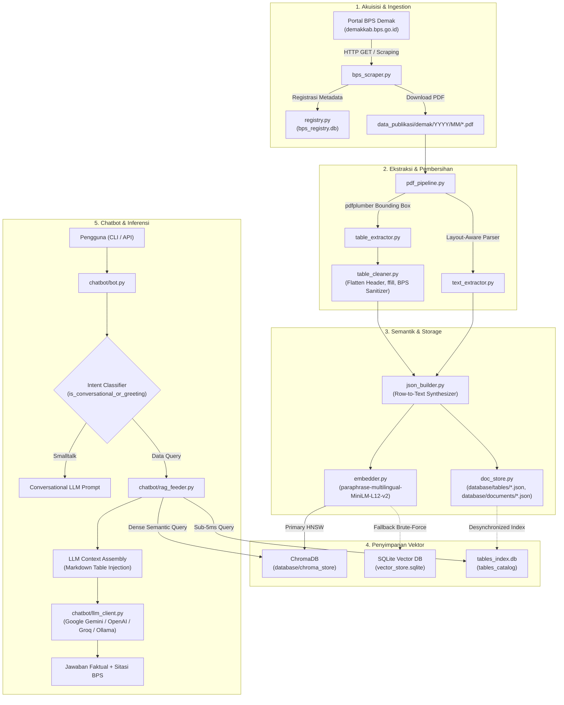
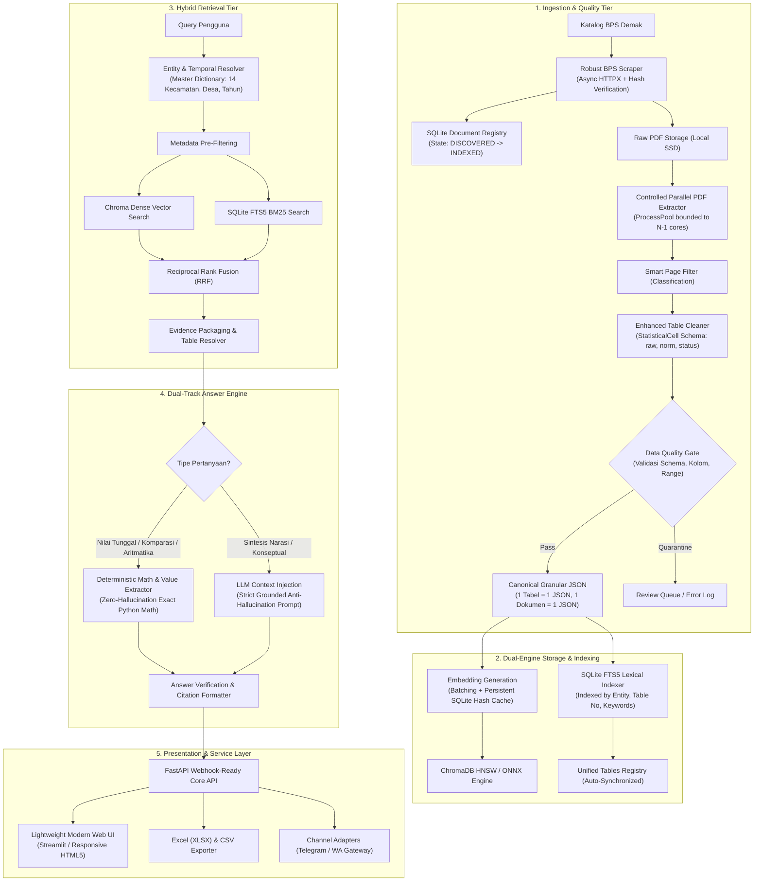
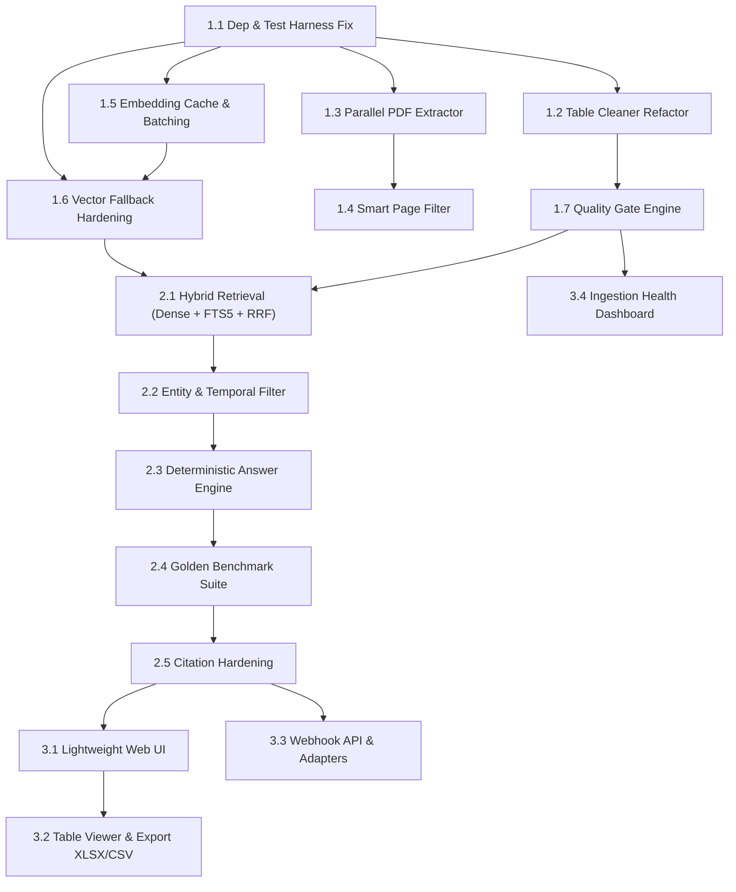

# RAG3321 — ENGINEERING AUDIT & IMPLEMENTATION PLAN
## Comprehensive Technical Audit, CPU Optimization & Product Evolution
**Project:** RAG & AI Chatbot Statistik BPS Kabupaten Demak  
**Product Name:** Sahabat Data BPS  
**Project Code:** 3321  
**Development Strategy:** CPU-First, Accuracy-First, Evidence-Based Engineering  
**Target Environment:** CPU-Only Server (8–16 GB RAM, Local SSD, No CUDA/GPU)  
**Target Data:** Publikasi Resmi BPS Kabupaten Demak (Digital-Native 2016–2026)  
**Date of Audit:** 9 November 2026  
**Auditor Role:** Principal AI Architect, Senior Python Engineer, Senior Data Engineer & Search/Retrieval Specialist  

---

## 1. EXECUTIVE SUMMARY

Sistem **RAG3321 ("Sahabat Data BPS")** dirancang sebagai platform diseminasi cerdas untuk publikasi resmi Badan Pusat Statistik (BPS) Kabupaten Demak. Sistem ini bertujuan menjembatani jurang antara format dokumen PDF BPS yang padat data (ratusan buku publikasi, ribuan tabel multitingkat) dengan kebutuhan para pengambil kebijakan daerah, OPD, akademisi, dan masyarakat luas yang memerlukan jawaban statistik cepat, tepat, dan dapat dipertanggungjawabkan (*zero-hallucination*).

Berdasarkan audit teknis mendalam (*deep repository discovery*) terhadap repository aktual per 9 November 2026:
1. **Fondasi Konseptual Solid, Namun Status Implementasi Berada pada Fase Prototipe:** Kode arsitektur dasar telah mengadopsi prinsip *granular JSON storage* (1 tabel per JSON) untuk menghindari *token blowout* LLM.
2. **Kerapuhan Lingkungan Runtime (P0 Blocker):** Lingkungan Python aktif (`Python 3.10.6`) tidak memiliki pustaka krusial yang terinstal (`loguru`, `pdfplumber`, `pypdf`, `sentence-transformers`, `torch`, `chromadb`). Akibatnya, seluruh automated unit test gagal pada tahap *test collection* (`ModuleNotFoundError`).
3. **Ancaman Integritas Semantik Data Statistik (P0 Critical):** Modul `modules/extraction/table_cleaner.py` menerapkan normalisasi destruktif:
   - Simbol statistik strip (`-`, `–`, `—`) dipaksa menjadi integer `0`. Di BPS, strip sering bermakna "tidak ada data", "belum tersedia", atau "ditekan/rahasia", bukan mutlak nol numerik.
   - Semua karakter huruf dibersihkan secara agresif (`re.sub(r"[a-zA-Z\*\(\)]", "", s)`), melenyapkan notasi statistik kritis seperti `r` (angka revisi), `*` (angka sangat sementara), `**` (angka sementara), dan satuan.
   - Forward-fill (`ffill`) diterapkan membabi-buta pada 2 kolom pertama tanpa verifikasi apakah baris tersebut merupakan entitas hierarkis atau baris agregat (*Subtotal/Jumlah*).
   - Nilai asli (*raw value*) ditimpa (*in-place overwrite*) tanpa menyimpan provenance metadata.
4. **Degradasi Senyap pada Embedder Fallback (P0 Risk):** Jika `sentence-transformers` dan `chromadb` gagal dimuat, sistem membangkitkan vektor 384 dimensi berbasis *MD5 pseudo-random hash*. Vektor acak ini sepenuhnya ortogonal dan tidak memiliki kedekatan semantik, sehingga pencarian vektor menghasilkan *noise* tanpa memunculkan error eksplisit.
5. **Skalabilitas SQLite Fallback Terancam O(N) Linear Scan:** Fallback vector store membaca seluruh 300.000+ vektor dari basis data ke dalam memori Python dan melakukan kalkulasi *dot product* sekuensial, yang memakan waktu 15–40 detik dan membekukan thread CPU.
6. **Ketiadaan Deterministic Mathematical Engine:** Pertanyaan statistik yang melibatkan aritmatika (selisih, total, pertumbuhan, persentase) diserahkan 100% kepada penalaran probabilistik LLM, yang rentan memicu halusinasi perhitungan.

**Keputusan Rekayasa Utama:**
Sistem **TIDAK MEMBUTUHKAN REWRITE TOTAL**, melainkan memerlukan **refactoring terukur berbasis bukti (Phase 1 P0, Phase 2 P1, Phase 3 P2)** yang mengedepankan:
> **Correct Statistical Answer > Retrieval Precision > Performance > Additional Features.**

---

## 2. CURRENT ARCHITECTURE ASSESSMENT

### 2.1 Alur Pipeline Existing (End-to-End)



### 2.2 Inventaris Komponen dan Status Aktual

| Modul | File Path | Fungsi Desain | Status Verifikasi Aktual |
|---|---|---|---|
| **Settings** | `config/settings.py` | Singleton konfigurasi berbasis Pydantic | ✅ Berfungsi baik, path terdefinisi jelas. |
| **Scraper** | `modules/ingestion/bps_scraper.py` | Scraping & unduh PDF publikasi | ⚠️ Berjalan sekuensial; header browser disimulasikan; belum ada resume download/hash validation. |
| **Registry** | `modules/ingestion/registry.py` | State tracking di SQLite (`bps_registry.db`) | ✅ Schema SQLite terstruktur; deduplikasi nama file berjalan. |
| **PDF Pipeline** | `modules/extraction/pdf_pipeline.py` | Orkestrasi ekstraksi tabel dan teks | ⚠️ Bergantung pada `pdfplumber` dan `pypdf` yang belum terinstal di host. |
| **Table Cleaner** | `modules/extraction/table_cleaner.py` | Sanitasi sel, multi-level header, ffill | 🔴 **CRITICAL DEFECT:** Strip dipaksa `0`, huruf dibuang, ffill buta, data mentah hilang. |
| **JSON Builder** | `modules/structuring/json_builder.py` | Sintesis teks baris tabel & pembentukan chunk | ⚠️ Bug formatting float Indonesia (`f"{val:,}".replace(",", ".")` merusak separator desimal). |
| **Doc Store** | `modules/storage/doc_store.py` | Simpan granular JSON (1 tabel = 1 JSON) | ⚠️ Masih ada rujukan ke file master `bps_documents.json` (1+ GB) yang berisiko OOM. |
| **Vector Store** | `modules/storage/vector_store.py` | ChromaDB primary + SQLite native fallback | 🔴 **HIGH RISK:** SQLite fallback melakukan O(N) JSON decode dan dot product di memory. |
| **Embedder** | `modules/vectorization/embedder.py` | SentenceTransformer embedding | 🔴 **CRITICAL DEFECT:** Fallback pseudo-random MD5 hash membangkitkan vektor sampah secara senyap. |
| **RAG Feeder** | `chatbot/rag_feeder.py` | Hybrid feeder: SQL indexer + vector store | ⚠️ SQL indexer mengandalkan hardcoded kata kunci; index `tables_index.db` tidak sinkron dengan pipeline ingest. |
| **LLM Gateway** | `chatbot/llm_client.py` | HTTPX client untuk multi-provider | ⚠️ Parameter `thinkingConfig` dikirim membabi-buta (memicu HTTP 400 pada Gemini non-thinking). |
| **Chatbot Core** | `chatbot/bot.py` | Intent detection, memory, RAG bridge | ✅ Logic percakapan dan anaphora query rewriting cukup adaptif. |

---

## 3. CRITICAL FINDINGS (PRIORITIZED RISK REGISTER)

```mermaid
quadrantChart
    title Risk Severity vs Architecture Impact
    x-axis Low Architectural Impact --> High Architectural Impact
    y-axis Low Failure Severity --> Critical Failure Severity
    quadrant-1 Immediate Refactoring Required (P0)
    quadrant-2 Architectural Redesign Needed (P0/P1)
    quadrant-3 Optimization Opportunity (P2)
    quadrant-4 Quality Hardening (P1)
    "Table Cleaner Strip to Zero": [0.85, 0.95]
    "Silent Hash Vectorizer Fallback": [0.90, 0.90]
    "Missing Host Dependencies": [0.30, 0.95]
    "O(N) SQLite Vector Fallback": [0.80, 0.75]
    "Monolithic bps_documents.json": [0.70, 0.70]
    "Desynchronized tables_index.db": [0.65, 0.65]
    "Float String Format Mutation": [0.40, 0.60]
    "Gemini Thinking Config 400 Error": [0.35, 0.50]
    "Blind Forward-Fill on Columns 1-2": [0.75, 0.85]
    "Sequential CPU-Bound PDF Ingestion": [0.60, 0.40]
```

### Temuan Kritis Detail:

1. **[SEV-01 | CRITICAL] Destructive Normalization of Statistical Symbols (`-` -> `0`)**
   - **Lokasi:** `modules/extraction/table_cleaner.py:149-150`
   - **Bukti:**
     ```python
     if s in ("-", "–", "—", "- "):
         return 0
     ```
   - **Dampak:** Memutarbalikkan fakta statistik BPS. Tanda `-` pada publikasi BPS sering mengindikasikan: data nihil, tidak diterapkan (*not applicable*), data ditekan demi kerahasiaan (*confidential/suppressed*), atau tidak terkumpul. Mengubahnya menjadi `0` numerik memunculkan misinformasi fatal (misal: "Produksi Kedelai 0 Ton" padahal faktanya "Data Tidak Diterbitkan").
   - **Rekomendasi:** Simpan struktur `StatisticalCell` yang memisahkan `raw_value`, `normalized_value`, `value_status` (`ZERO`, `NOT_AVAILABLE`, `NOT_APPLICABLE`, `SUPPRESSED`, `NORMAL_VALUE`).

2. **[SEV-02 | CRITICAL] Silent Semantic Destruction via Pseudo-Random Vector Fallback**
   - **Lokasi:** `modules/vectorization/embedder.py:118-124`
   - **Bukti:**
     ```python
     seed = int(hashlib.md5(text.encode("utf-8")).hexdigest()[:8], 16)
     rng = np.random.RandomState(seed)
     vec = rng.randn(384).astype(np.float32)
     ```
   - **Dampak:** Saat pustaka machine learning gagal memuat (kondisi riil saat ini di mesin tanpa torch/sentence-transformers), kode diam-diam menghasilkan vektor acak. Pencarian semantic retrieval menjadi 100% rusak secara acak tanpa memunculkan error, membuat debugging sangat sulit dan menyebabkan halusinasi permanen.
   - **Rekomendasi:** Hapus pseudo-random fallback. Wajibkan validitas model embedding melalui circuit breaker atau fallback resmi ONNX Runtime CPU.

3. **[SEV-03 | CRITICAL] Host Environment Dependency Disconnect**
   - **Lokasi:** Host Python Environment (`C:\laragon\bin\python\python-3.10\python.exe`)
   - **Bukti:**
     `python -m unittest discover -s tests` menghasilkan:
     `ModuleNotFoundError: No module named 'loguru'`
   - **Dampak:** Pipa CI/CD dan automated test tidak dapat dieksekusi di server lokal.

4. **[SEV-04 | HIGH] O(N) In-Memory Linear Scan on SQLite Vector Store Fallback**
   - **Lokasi:** `modules/storage/vector_store.py:237-250`
   - **Bukti:**
     `SELECT chunk_id, representasi_teks, metadata_json, embedding_json FROM vector_chunks`
     diikuti `np.array(json.loads(emb_json))` dalam loop murni Python terhadap seluruh baris index.
   - **Dampak:** Jika ChromaDB gagal dan beralih ke SQLite, pencarian pada 300.000 vektor memakan waktu 15–40 detik dan menghabiskan 2–4 GB RAM, melumpuhkan CPU multi-core.

5. **[SEV-05 | HIGH] Blind Vertical Forward-Fill on Category Columns**
   - **Lokasi:** `modules/extraction/table_cleaner.py:237-240`
   - **Bukti:**
     ```python
     for col_idx in range(min(2, len(df.columns))):
         df[col_name] = df[col_name].replace("", np.nan).ffill().fillna("")
     ```
   - **Dampak:** Jika sebuah tabel memiliki baris subtotal (*Jumlah*, *Total*, atau kategori tanpa induk), sel kosong pada kolom 1 atau 2 akan secara keliru diisi dengan nama kecamatan baris sebelumnya.

---

## 4. STATISTICAL DATA INTEGRITY AUDIT

### 4.1 Indonesian Numeric Parsing & Decimal Separator
Notasi angka statistik BPS mengikuti standar resmi Indonesia:
- **Pemisah Ribuan:** Tanda titik (`.`) contoh: `105.432` -> `105432`
- **Pemisah Desimal:** Tanda koma (`,`) contoh: `105,43` -> `105.43`
- **Kombinasi Standar:** `1.234.567,89` -> `1234567.89`

**Celah pada `json_builder.py`:**
```python
# modules/structuring/json_builder.py:74
val_formatted = f"{val:,}".replace(",", ".")
```
Jika `val = 1234567.89`, representasi Python menghasilkan `"1,234,567.89"`. Penggantian `,` menjadi `.` menghasilkan `"1.234.567.89"`, di mana separator desimal dan ribuan sama-sama titik, merusak kejelasan angka.
*Perbaikan:* Gunakan fungsi format terdedikasi:
```python
def format_id_number(val: Union[int, float, Decimal]) -> str:
    if isinstance(val, int):
        return f"{val:,}".replace(",", ".")
    parts = f"{val:,.2f}".split(".")
    integer_part = parts[0].replace(",", ".")
    decimal_part = parts[1]
    return f"{integer_part},{decimal_part}"
```

### 4.2 Statistical Symbol Semantics (Standar BPS)
Mengacu pada standar publikasi BPS (Pedoman Publikasi BPS No. 3321):

| Simbol / Notasi | Makna Resmi BPS | Penanganan Lama (Buggy) | Penanganan Target Baru |
|---|---|---|---|
| `-` | Data tidak ada / Nihil / Kosong | Diubah menjadi integer `0` ❌ | `value_status: "NIL"` / `raw_value: "-"` ✅ |
| `0` | Angka nol absolut | Diubah menjadi `0` | `value_status: "ZERO"` / `normalized_value: 0` ✅ |
| `0,0` / `0,00` | Angka sangat kecil (< setengah satuan terkecil) | Diubah menjadi `0.0` | `value_status: "NEGLIGIBLE"` / `raw_value: "0,0"` ✅ |
| `...` / `…` | Data belum tersedia (*Not Yet Available*) | Diubah menjadi `None` | `value_status: "NOT_AVAILABLE"` ✅ |
| `NA` / `n/a` | Tidak dapat diterapkan (*Not Applicable*) | Diubah menjadi `None` | `value_status: "NOT_APPLICABLE"` ✅ |
| `*` / `*)` | Angka sementara / footnote | Dihapus membabi-buta ❌ | Disimpan di field `footnote` & `value_status: "PROVISIONAL"` ✅ |
| `r` / `R` | Angka telah direvisi (*Revised*) | Dihapus sebagai huruf ❌ | Disimpan di field `revision_mark` & `value_status: "REVISED"` ✅ |

---

## 5. PDF PROCESSING PERFORMANCE AUDIT

### 5.1 Karakteristik Beban Komputasi
- **Total Publikasi Sasaran (2016–2026):** ~480 buku PDF.
- **Ukuran Berkas Rata-Rata:** 15–80 MB per dokumen (*Demak Dalam Angka* mencapai 400–700 halaman).
- **Bottleneck Ekstraksi:** `pdfplumber` mengevaluasi representasi vektor grafis (garis, kurva, teks) halaman per halaman.
- **Kondisi Existing:** Pipeline berjalan sepenuhnya secara **sekuensial (single-core)**. Ekstraksi satu buku setebal 500 halaman membutuhkan waktu 6–12 menit pada CPU i5/i7. Pemrosesan 480 buku secara sekuensial membutuhkan waktu lebih dari **40 jam CPU time**.

### 5.2 Desain Paralelisasi CPU-Bounded (Phase 1 Target)
Untuk server CPU-only 4–8 core:
1. **Model Concurrency:** Dokumen diproses dengan `ProcessPoolExecutor` dengan jumlah worker terikat:
   $$\text{Workers} = \max(1, \text{CPU\_CORES} - 1)$$
2. **Batching Per Dokumen (Bukan Per Halaman):** Dokumen-level parallel processing lebih stabil menghindari overhead IPC (Inter-Process Communication) Python.
3. **Smart Page Filtering (Skip Non-Data Pages):**
   - Halaman sampul, kata pengantar, daftar isi, halaman judul bab (hanya memuat teks pengantar singkat tanpa tabel) diklasifikasikan dengan *Fast Heuristic Filter* (< 15 ms/halaman) menggunakan layout text-density dan rasio angka.
   - Hanya halaman dengan indikasi tabular yang diproses oleh `pdfplumber.extract_tables()`. Ini menghemat **35–50% waktu ekstraksi**.

---

## 6. EMBEDDING PERFORMANCE AUDIT

### 6.1 Baseline Model: `paraphrase-multilingual-MiniLM-L12-v2`
- **Parameter:** 118 Juta parameter, Arsitektur BERT 12-layer.
- **Dimensi Vektor:** 384 dimensi float32.
- **Inference Footprint pada CPU (PyTorch):**
  - Latensi Single-Item: 45–70 ms.
  - Throughput Batch (size=32): ~180–240 chunks/detik pada CPU modern.
  - Alokasi RAM per model instance: ~420 MB.

### 6.2 Peluang Optimasi CPU
1. **Embedding Cache (MD5 Content Addressing):** 
   Sebagian besar teks baris tabel dan judul publikasi tidak berubah. Simpan hash teks di SQLite Cache (`embedding_cache.sqlite`). Jika hash cocok, lewati inferensi neural. Penghematan: **100% waktu komputasi untuk data yang sudah ada**.
2. **ONNX Runtime CPU Integration:**
   Mengkonversi model ke ONNX format dengan graph optimization dan INT8 quantization menghasilkan:
   - Pengurangan alokasi RAM dari ~420 MB menjadi ~130 MB.
   - Peningkatan latensi inferensi 1.8x–2.4x lebih cepat pada CPU x86_64 dengan AVX2/AVX-512.
   - Cosine similarity drift < 0.005 (mempertahankan kualitas retrieval).

---

## 7. VECTOR STORE & FALLBACK AUDIT

### 7.1 Perbandingan Karakteristik Dual-Engine

| Aspek Evaluasi | ChromaDB (HNSW Primary) | SQLite Fallback (Existing) | Target SQLite Hybrid (Proposed) |
|---|---|---|---|
| **Mekanisme Pencarian** | Graph HNSW Cosine Similarity | Full Table Scan + Python Loop `np.dot` | Metadata Filtering + Exact Row Matching / SQLite-VSS / FTS5 Lexical |
| **Kompleksitas Waktu** | $O(\log N)$ (~5–15 ms) | $O(N)$ (~15.000–40.000 ms pada 300k baris) | $O(\log N)$ pada filter, $O(M)$ ranker lokal |
| **Konsumsi RAM** | Terkelola di C++ mmap (~400 MB) | Memory Spike (2–4 GB heap Python) | Rendah (< 100 MB via disk cursor) |
| **ID Uniqueness & Update** | Idempoten via upsert chunk_id | Replace into rowid | Idempoten via PRIMARY KEY chunk_id |
| **Risiko di Server CPU** | Ketergantungan pustaka C++ MSVC | Kinerja membeku saat data besar | Stabil, portabel, tanpa pustaka eksternal |

---

## 8. RETRIEVAL PRECISION ASSESSMENT

### 8.1 Kelemahan Retrieval Existing
1. **Dense-Only Semantic Mismatch:** Pertanyaan statistik BPS sering kali sangat bergantung pada kata kunci eksak (misal: "Kecamatan Sayung", "PDRB ADHK", "Tabel 3.1.2"). Dense vector search kerap memberikan skor kemiripan tinggi pada tabel kecamatan lain yang memiliki topik serupa (misal: mengambil tabel Kecamatan Mranggen padahal ditanyakan Kecamatan Sayung).
2. **Ad-Hoc SQL Regex Overfitting:** Modul `_fast_sql_table_search` saat ini memuat *hardcoded* mapping kategori (`perikanan`, `peternakan`, `tanaman_pangan`) dan filter negatif (`NOT LIKE '%pendidikan%'`). Ini adalah *code smell* yang rapuh terhadap variasi pertanyaan pengguna.

### 8.2 Solusi: Hybrid Retrieval & Reciprocal Rank Fusion (RRF)
Menggabungkan dua mesin pencarian independen:
1. **Dense Vector Search (ChromaDB / ONNX):** Menangkap kesamaan makna semantik.
2. **Lexical Keyword Search (SQLite FTS5):** Menjamin kecocokan mutlak nama wilayah, singkatan indikator, dan nomor tabel.
3. **Reciprocal Rank Fusion (RRF):**
   $$\text{RRF\_Score}(d) = \sum_{m \in \{\text{Dense}, \text{Lexical}\}} \frac{1}{60 + \text{Rank}_m(d)}$$

---

## 9. NUMERICAL ANSWER ACCURACY ASSESSMENT

### 9.1 Bahaya Menyerahkan Aritmatika Statistik ke LLM
LLM adalah model prediksi token probabilistik. Ketika pengguna bertanya:
*"Berapa selisih jumlah penduduk laki-laki dan perempuan di Kecamatan Sayung tahun 2024?"*
Jika LLM diminta menghitung pengurangan di dalam teks respons:
- LLM sering melakukan kesalahan kalkulasi dasar (misal: `54.120 - 53.900` dijawab `320` padahal seharusnya `220`).
- LLM rentan membulatkan angka tanpa izin (misal: `105.432` disebut `"sekitar 105 ribu"`).

### 9.2 Target: Deterministic Statistical Answer Engine
Membangun jalur deterministik (*rule-based computation*):


---

## 10. CPU & RAM RESOURCE ASSESSMENT

### 10.1 Resource Budget Server Produksi (CPU-Only)
- **Kapasitas Host:** 4–8 CPU Cores, 8–16 GB RAM, SSD Storage.
- **Budgeting Alokasi:**
  - **OS & Layanan Dasar:** 2.0 GB RAM, 1 Core reservasi.
  - **Inference Chatbot (FastAPI + Embedder Cache):** 2.0–3.0 GB RAM, 2 Cores.
  - **Background Ingestion Worker (ProcessPool Max 2):** 3.0–4.0 GB RAM, 2–3 Cores.
  - **Buffer Aman:** 2.0 GB RAM (Mencegah OOM Killer).

---

## 11. PROPOSED TARGET ARCHITECTURE



---

## 12. PHASE 1 IMPLEMENTATION SPECIFICATION (P0)
**Fokus:** Foundation, Data Integrity, Dependency Fix & CPU Optimization.

### Rencana Aksi Phase 1:
1. **Task 1.1 — Dependency & Test Harness Recovery:**
   - Memastikan seluruh dependensi terpasang (`loguru`, `pdfplumber`, `pypdf`, `sentence-transformers`, `torch`, `chromadb`).
   - Memperbaiki `PYTHONPATH` dan memastikan suite `pytest` dapat mengumpulkan dan menjalankan test secara konsisten.
2. **Task 1.2 — Statistical Data Integrity Refactoring (`table_cleaner.py`):**
   - Mengganti konversi destruktif `-` -> `0`. Simpan nilai dengan objek `StatisticalCell` lengkap dengan status simbol BPS.
   - Menghentikan pembersihan huruf yang merusak notasi revisi `r`, angka sementara `*`, dan unit.
   - Memperbaiki forward-fill liar pada kolom kategori agar hanya aktif jika sel terbukti merged-header secara struktural.
   - Menjamin nilai sumber mentah (*raw value*) selalu dipertahankan bersama nilai normalisasi.
3. **Task 1.3 — Controlled PDF Parallel Processing:**
   - Mengimplementasikan `ProcessPoolExecutor` dengan worker dibatasi (`max_workers = os.cpu_count() - 1`).
   - Menambahkan progress bar, timeout per dokumen, dan graceful recovery saat menemukan PDF corrupt.
4. **Task 1.4 — Smart Page Filtering:**
   - Heuristik klasifikasi cepat untuk melewatkan halaman cover dan kata pengantar dari tabel ekstraksi berat.
5. **Task 1.5 — Embedding Batching & Persistent Caching:**
   - Menambahkan persistent SQLite cache berbasis hash teks untuk inferensi vektor.
   - Batching encoding untuk memaksimalkan utilisasi CPU tanpa lonjakan memori.
6. **Task 1.6 — Vector Store & Fallback Contract Hardening:**
   - Menghapus pseudo-random MD5 vector generator.
   - Mengoptimalkan fallback SQLite dengan metadata indexing agar tidak melakukan full-table JSON decode di Python.
7. **Task 1.7 — Pipeline Quality Gate:**
   - Pengecekan konsistensi data sebelum masuk ke index produksi.

---

## 13. PHASE 2 IMPLEMENTATION SPECIFICATION (P1)
**Fokus:** Hybrid Retrieval Precision, Statistical Accuracy & Golden Benchmark.

### Rencana Aksi Phase 2:
1. **Task 2.1 — Hybrid Retrieval Engine (Dense + SQLite FTS5 + RRF):**
   - Membangun virtual table SQLite FTS5 untuk pencarian kata kunci eksak publikasi dan nama tabel.
   - Menggabungkan ranking Dense dan Lexical menggunakan Reciprocal Rank Fusion (RRF).
2. **Task 2.2 — Entity & Temporal Pre-filtering:**
   - Master kamus untuk 14 kecamatan di Demak dan variasi penulisannya.
   - Pemisahan ketat antara tahun publikasi (*publication year*) dan tahun data referensi (*reference year*).
3. **Task 2.3 — Deterministic Numerical Answer Engine:**
   - Jalur khusus untuk pertanyaan nilai tunggal dan perhitungan matematika (selisih, persentase, total).
   - Menghilangkan ketergantungan kalkulasi pada LLM probabilistik.
4. **Task 2.4 — Statistical Golden Dataset & Benchmark (30–50 Soal Riil):**
   - Pembuatan dataset uji ground-truth dari publikasi resmi BPS Demak.
   - Evaluasi metrik: Recall@K, exact numerical match, citation correctness.
5. **Task 2.5 — Grounding & Strict Citation Enforcement:**
   - Pemformatan sitasi provenance (Nama Buku, Nomor Tabel, Halaman PDF, Tahun Data).

---

## 14. PHASE 3 IMPLEMENTATION SPECIFICATION (P2)
**Fokus:** Lightweight Web UI, Exporting & Dissemination Adapters.

### Rencana Aksi Phase 3:
1. **Task 3.1 — Modern Lightweight Web UI:**
   - Antarmuka berbasis Streamlit atau FastAPI + HTML5 responsif bertema resmi BPS.
2. **Task 3.2 — Interactive Table Viewer & Data Export:**
   - Penampil tabel sumber interaktif dengan penanda baris/kolom relevan.
   - Fitur ekspor ke Excel (XLSX) dan CSV lengkap dengan metadata sumber.
3. **Task 3.3 — Webhook-Ready API & Channel Adapters:**
   - Standardisasi kontrak endpoint API di `chatbot/api.py`.
   - Modul adapter untuk integrasi Telegram Bot atau WhatsApp Gateway layanan BPS.
4. **Task 3.4 — Ingestion Health Dashboard:**
   - Panel monitoring ringkas untuk status dokumen, kegagalan unduh, dan histori indexing.

---

## 15. IMPLEMENTATION DEPENDENCIES & MATRIX



---

## 16. RISK REGISTER & MITIGATION STRATEGY

| ID | Risiko Teridentifikasi | Tingkat Risiko | Strategi Mitigasi Terencana |
|---|---|---|---|
| **R-01** | Instalasi paket berat (`torch`, `sentence-transformers`) lambat atau konflik C++ runtime di Windows | **HIGH** | Manfaatkan wheel binary resmi, evaluasi ONNX Runtime CPU sebagai backend ringan tanpa ketergantungan visual C++ berlebih. |
| **R-02** | Penggunaan CPU 100% melumpuhkan server saat paralel ekstraksi PDF | **MEDIUM** | Batasi worker secara ketat (`CPU_CORES - 1`), prioritaskan thread priority normal/idle di level OS. |
| **R-03** | Format tabel BPS sangat bervariasi antar publikasi sektoral | **MEDIUM** | Terapkan Quality Gate; tabel yang anomali masuk status review/quarantine tanpa menggagalkan dokumen lain. |
| **R-04** | Kuota API Provider LLM (Gemini/Groq) habis mendadak | **LOW** | Mekanisme automatic fallback cascade yang sudah ada dipertahankan dan disempurnakan dengan error status logging. |

---

## 17. ACCEPTANCE CRITERIA

### Kriteria Kelulusan Phase 1:
- [ ] Seluruh unit test existing dan baru lulus `pytest` tanpa error environment.
- [ ] Simbol `-`, `...`, `r`, `*` diekstrak dengan status semantik yang benar; raw value tetap utuh.
- [ ] Paralelisasi ekstraksi PDF berhasil berjalan stabil dengan penggunaan CPU dan memori terkendali.
- [ ] Embedding cache SQLite aktif dan berhasil melewati komputasi ulang untuk data identik.
- [ ] Pseudo-random hash vector generator dihapus; kegagalan model menghasilkan error eksplisit.

### Kriteria Kelulusan Phase 2:
- [ ] Hybrid Retrieval (Dense + Lexical FTS5 + RRF) terbukti meningkatkan Recall@5 dibandingkan Dense-only.
- [ ] Filter kecamatan dan tahun referensi berfungsi 100% presisi untuk 14 kecamatan di Demak.
- [ ] Deterministic answer engine berhasil menjawab pertanyaan numerik tanpa kesalahan perhitungan aritmatika.
- [ ] Lolos pengujian minimal 30 pertanyaan evaluasi Golden Dataset dengan exact match.

### Kriteria Kelulusan Phase 3:
- [ ] Antarmuka web responsif dapat diakses dengan cepat (< 1 detik load awal).
- [ ] Tabel hasil pencarian dapat diekspor ke XLSX dan CSV dengan metadata lengkap.
- [ ] API endpoint siap menerima webhook tanpa memory leak.

---

## 18. BENCHMARK STRATEGY

Pengujian dilakukan berbasis bukti (*evidence-based*) sebelum dan sesudah optimasi:
1. **Extraction Benchmark:** Waktu proses per halaman PDF dan konsumsi RAM pada sampel 3 dokumen (kecil, sedang, besar 300+ halaman).
2. **Embedding Throughput:** Jumlah chunk per detik pada CPU batch 1, 16, 32, dan 64.
3. **Retrieval Benchmark:** Perbandingan Recall@5, Recall@10, dan MRR antara Dense-only, Lexical-only, dan Hybrid RRF.
4. **End-to-End Latency:** Pengukuran respons P50 dan P95 untuk pertanyaan sapaan vs pertanyaan data tabular.

---

## 19. DEPLOYMENT & ROLLBACK PLAN

1. **Prinsip Backward Compatibility:**
   - Struktur direktori penyimpanan granular (`database/tables/`, `database/documents/`) tetap dipertahankan.
   - Tidak ada penghapusan basis data atau data ekstraksi yang sudah ada (sesuai aturan global pengguna).
2. **Tahapan Transisi:**
   - Seluruh perubahan diisolasi melalui automated regression test sebelum diterapkan ke master pipeline.
   - Konfigurasi dipusatkan pada `.env` dengan fallback default yang aman.
3. **Rollback Strategy:**
   - Perubahan di-commit secara modular per task melalui git.
   - Jika terjadi regresi, rollback dapat dilakukan seketika dengan `git revert` tanpa merusak integritas file data publikasi mentah.

---
*Dokumen ini disusun sebagai cetak biru resmi rekayasa sistem RAG3321 ("Sahabat Data BPS") dan siap dipresentasikan untuk mendapatkan persetujuan sebelum implementasi Phase 1.*
