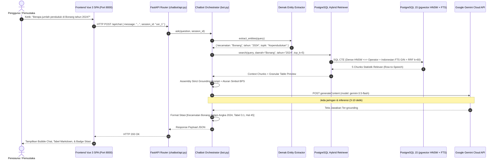
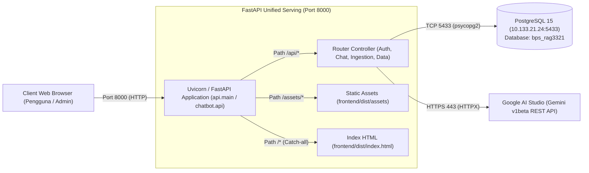

# 📊 DETAILED SYSTEM FLOW, ARCHITECTURE, ERD & API DOCUMENTATION

Dokumen ini memuat dokumentasi teknis mendalam mengenai arsitektur sistem, diagram alir lengkap (*flowchart*), diagram sekuensial (*sequence diagram*), *Entity Relationship Diagram* (ERD), skema basis data PostgreSQL, dokumentasi 20 endpoint API, serta contoh nyata kueri dan respons ber-sitasi.

---

## 1. Sequence Diagram: Alur Siklus Kueri Obrolan Pengguna



---

## 2. Entity Relationship Diagram (ERD) Basis Data

```mermaid
erDiagram
    PUBLICATIONS ||--o{ STATISTICAL_TABLES : "memiliki relasi 1:N tabel"
    STATISTICAL_TABLES ||--o{ VECTOR_CHUNKS : "dipecah menjadi 1:N chunks"
    VECTOR_CHUNKS }o--|| EMBEDDING_CACHE : "memanfaatkan hash cache"

    PUBLICATIONS {
        text publication_id PK
        text title
        text release_date
        text category
        text pdf_url
        text local_file_path
        text checksum_sha256
        int total_tables_extracted
        int total_chunks_indexed
        text download_status
        text extraction_status
        timestamptz created_at
        timestamptz updated_at
    }

    STATISTICAL_TABLES {
        text table_id PK
        text doc_id FK
        text doc_title
        text table_title
        text table_number
        text kecamatan
        text tahun
        text satuan
        text sumber
        text catatan
        int halaman
        jsonb kolom
        jsonb records
        timestamptz created_at
    }

    VECTOR_CHUNKS {
        text chunk_id PK
        text doc_id FK
        text table_id FK
        text judul_tabel
        text daerah
        text tahun
        text kategori
        text tipe_konten
        text satuan
        text sumber
        int halaman
        text representasi_teks
        jsonb metadata
        vector_384 embedding
        tsvector tsv
    }

    EMBEDDING_CACHE {
        text text_hash PK
        text model_name
        vector_384 embedding
        timestamptz created_at
    }
```



---

## 3. Skema Fisik SQL Aktual (PostgreSQL DDL)

Berikut adalah definisi skema tabel aktif pada instance `10.133.21.24:5433`:

```sql
-- 1. Ekstensi Vektor
CREATE EXTENSION IF NOT EXISTS vector;

-- 2. Tabel Cache Embedding Persisten
CREATE TABLE IF NOT EXISTS embedding_cache (
    text_hash VARCHAR(64) PRIMARY KEY,
    model_name VARCHAR(255) NOT NULL,
    embedding vector(384) NOT NULL,
    created_at TIMESTAMP WITH TIME ZONE DEFAULT CURRENT_TIMESTAMP
);

-- 3. Tabel Publikasi BPS
CREATE TABLE IF NOT EXISTS publications (
    publication_id VARCHAR(255) PRIMARY KEY,
    title TEXT NOT NULL,
    release_date VARCHAR(50),
    category VARCHAR(100),
    pdf_url TEXT,
    local_file_path TEXT,
    checksum_sha256 VARCHAR(64),
    file_size_bytes BIGINT,
    total_tables_extracted INT DEFAULT 0,
    total_chunks_indexed INT DEFAULT 0,
    download_status VARCHAR(50) DEFAULT 'PENDING',
    extraction_status VARCHAR(50) DEFAULT 'PENDING',
    created_at TIMESTAMP WITH TIME ZONE DEFAULT CURRENT_TIMESTAMP,
    updated_at TIMESTAMP WITH TIME ZONE DEFAULT CURRENT_TIMESTAMP
);

-- 4. Tabel Statistik Terstruktur (JSONB)
CREATE TABLE IF NOT EXISTS statistical_tables (
    table_id VARCHAR(255) PRIMARY KEY,
    doc_id VARCHAR(255) NOT NULL,
    doc_title TEXT NOT NULL,
    table_title TEXT NOT NULL,
    table_number VARCHAR(100),
    kecamatan VARCHAR(100),
    tahun VARCHAR(20),
    satuan VARCHAR(100),
    sumber TEXT,
    catatan TEXT,
    halaman INT,
    kolom JSONB NOT NULL,
    records JSONB NOT NULL,
    created_at TIMESTAMP WITH TIME ZONE DEFAULT CURRENT_TIMESTAMP
);

-- 5. Tabel Vector Chunks (HNSW & FTS)
CREATE TABLE IF NOT EXISTS vector_chunks (
    chunk_id VARCHAR(255) PRIMARY KEY,
    doc_id VARCHAR(255) NOT NULL,
    table_id VARCHAR(255),
    judul_tabel TEXT,
    daerah VARCHAR(100),
    tahun VARCHAR(20),
    kategori VARCHAR(100),
    tipe_konten VARCHAR(50),
    satuan VARCHAR(100),
    sumber TEXT,
    halaman INT,
    representasi_teks TEXT NOT NULL,
    metadata JSONB NOT NULL,
    embedding vector(384),
    tsv tsvector
);

-- 6. Indeks Performa Tinggi
CREATE INDEX IF NOT EXISTS idx_chunks_embedding_hnsw 
ON vector_chunks USING hnsw (embedding vector_cosine_ops) 
WITH (m = 16, ef_construction = 64);

CREATE INDEX IF NOT EXISTS idx_chunks_tsv 
ON vector_chunks USING gin (tsv);

CREATE INDEX IF NOT EXISTS idx_chunks_daerah ON vector_chunks (daerah);
CREATE INDEX IF NOT EXISTS idx_chunks_tahun ON vector_chunks (tahun);
CREATE INDEX IF NOT EXISTS idx_chunks_kategori ON vector_chunks (kategori);
CREATE INDEX IF NOT EXISTS idx_chunks_tipe ON vector_chunks (tipe_konten);
```

---

## 4. Dokumentasi Lengkap 20 Endpoint API

| No | HTTP Method | Path Endpoint | Controller Handler | Deskripsi Fungsi | Parameter Input | Output Respons |
|:--:|:---:|:---|:---|:---|:---|:---|
| 1 | `POST` | `/api/chat` | `api_chat` | Endpoint utama dialog tanya jawab statistik publik | `ChatRequest` (message, session_id, daerah, tahun) | JSON `{ status, data: { answer, citations, session_id } }` |
| 2 | `GET` | `/api/health` | `api_health` | Healthcheck dasar ketersediaan service API | None | JSON `{ status: "healthy", service: "..." }` |
| 3 | `DELETE` | `/api/session/{session_id}` | `api_clear_session` | Menghapus riwayat memory percakapan per session | `session_id` (path) | JSON `{ status: "success", message: "..." }` |
| 4 | `GET` | `/auth/callback` | `top_level_auth_callback` | Alias penangkap redirect OAuth2 dari provider SSO | `code`, `state`, `error` | Redirect ke `/admin` dengan token |
| 5 | `GET` | `/api/auth/me` | `get_current_user` | Memverifikasi sesi token login admin aktif | Header `Authorization: Bearer` | JSON `{ authenticated: bool, user: {...} }` |
| 6 | `POST` | `/api/auth/mock-login` | `mock_login` | Login instan admin development tanpa server SSO | JSON `{ username, name, nip, role }` | JSON `{ status, access_token, user }` |
| 7 | `POST` | `/api/auth/logout` | `logout` | Mengakhiri sesi login admin | Header `Authorization: Bearer` | JSON `{ status: "success", message: "..." }` |
| 8 | `GET` | `/api/auth/sipetra/redirect` | `sipetra_redirect` | Menghasilkan URL otorisasi SSO SIPETRA BPS | None | JSON `{ status, auth_url, client_id }` |
| 9 | `GET` | `/api/auth/sipetra/callback` | `sipetra_callback` | Memproses kode otorisasi OAuth2 menjadi token | Query: `code`, `state` | Redirect response |
| 10 | `GET` | `/api/auth/callback` | `sipetra_callback` | Alias callback sekunder OAuth2 | Query: `code`, `state` | Redirect response |
| 11 | `GET` | `/api/ingestion/status` | `get_ingestion_status` | Memantau persentase progres dan log scraper live | None | JSON `{ status, progress_pct, current_phase, logs }` |
| 12 | `POST` | `/api/ingestion/run` | `run_ingestion` | Memicu crawler background thread (statis/all/test) | `ScraperRunRequest` (mode, max_pages) | JSON `{ status: "RUNNING", job_id, message }` |
| 13 | `POST` | `/api/ingestion/stop` | `stop_ingestion` | Membatalkan job scraper yang sedang berjalan | None | JSON `{ status: "STOPPING", message }` |
| 14 | `GET` | `/api/data/tables` | `get_statistical_tables` | Mengambil tabel statistik dengan filter & pagination | Query: `search`, `kecamatan`, `tahun`, `page`, `limit` | JSON `{ total, page, items: [ { table_id, title... } ] }` |
| 15 | `GET` | `/api/data/table/{table_id}` | `get_table_detail` | Mengambil struktur kolom dan records lengkap 1 tabel | `table_id` (path) | JSON `{ status, data: { table_id, kolom, records } }` |
| 16 | `GET` | `/api/data/publications` | `get_publications_list` | Mengambil daftar publikasi BPS yang terdaftar di DB | Query: `limit`, `search` | JSON `{ total, items: [ { publication_id, title... } ] }` |
| 17 | `GET` | `/api/system/health` | `get_system_health` | Cek status koneksi DB, pgvector, dan model LLM | None | JSON `{ database: {...}, pgvector: {...}, llm: {...} }` |
| 18 | `GET` | `/api/system/vector-stats` | `get_vector_observability_stats` | Statistik total chunk HNSW, cache hit, dan per tahun | None | JSON `{ total_chunks, cached_embeddings, total_tables }` |
| 19 | `POST` | `/api/system/test-search` | `test_hybrid_search` | Form uji pencarian semantik hibrida langsung dari UI | JSON `{ query, top_k, daerah }` | JSON `{ query, total_results, results: [...] }` |
| 20 | `GET` | `/api/system/logs` | `get_recent_system_logs` | Membaca potongan file log backend Loguru terkini | Query: `lines` (default: 100) | JSON `{ log_file, total_lines, content: [...] }` |

---

## 5. Arsitektur Deployment Single-Port Serving



---

## 6. Contoh Nyata Kueri RAG, Hasil Retrieval & Sitasi Fakta

### Contoh Kasus 1: Kueri Kependudukan Spesifik
- **Pertanyaan Pengguna:** *"Berapa jumlah penduduk di Kecamatan Bonang pada tahun 2024?"*
- **Hasil Ekstraksi Entitas:** `daerah: 'Bonang'`, `tahun: '2024'`.
- **Top-1 Chunk yang Diambil (Row-to-Speech):**
  > *"Berdasarkan Tabel: 'Jumlah Penduduk Menurut Jenis Kelamin dan Kecamatan di Kabupaten Demak' (Kecamatan Bonang Dalam Angka 2024, Tahun 2024): Pada Kecamatan 'Bonang', nilai Jumlah Penduduk Laki-Laki adalah 54.120 Jiwa, nilai Jumlah Penduduk Perempuan adalah 53.015 Jiwa, nilai Jumlah Penduduk Total adalah 107.135 Jiwa."*
- **Jawaban Final Sistem:**
  > *"Berdasarkan data resmi BPS Kabupaten Demak, jumlah penduduk di Kecamatan Bonang pada tahun 2024 tercatat sebanyak **107.135 Jiwa**, terdiri atas 54.120 jiwa laki-laki dan 53.015 jiwa perempuan.\n\nSumber rujukan: [Kecamatan Bonang Dalam Angka 2024, Tabel 3.1, Hal. 45]"*

### Contoh Kasus 2: Kueri Pertanian Makro
- **Pertanyaan Pengguna:** *"Berapa luas panen padi di Kabupaten Demak tahun 2023?"*
- **Jawaban Final Sistem:**
  > *"Berdasarkan publikasi Kabupaten Demak Dalam Angka 2024, luas panen padi di Kabupaten Demak pada tahun 2023 adalah sebesar **94.851 Hektar**.\n\nSumber rujukan: [Kabupaten Demak Dalam Angka 2024, Tabel 5.1.1, Hal. 210]"*
