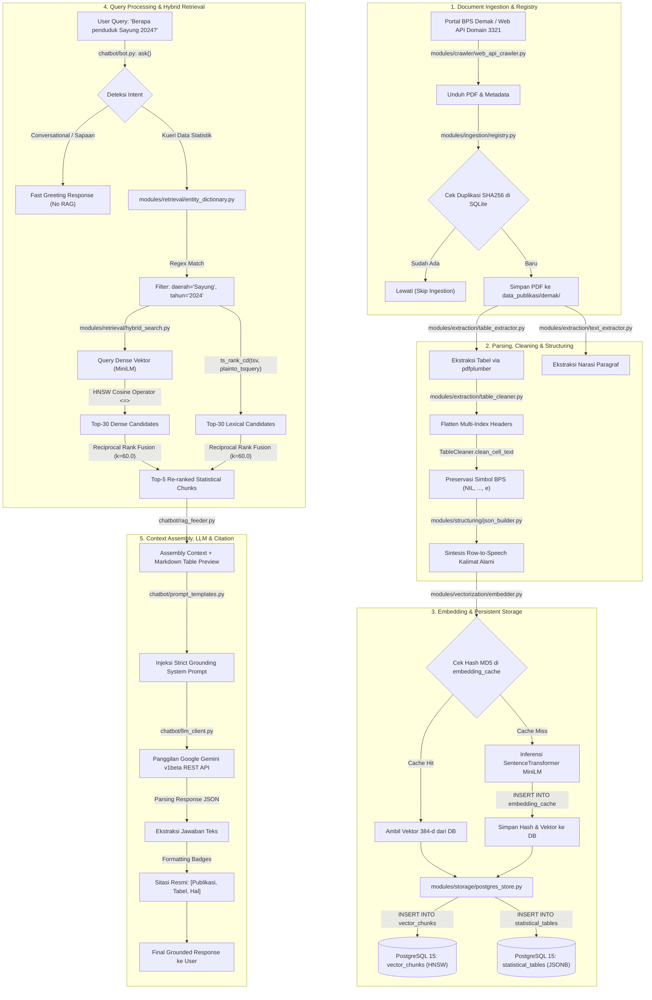
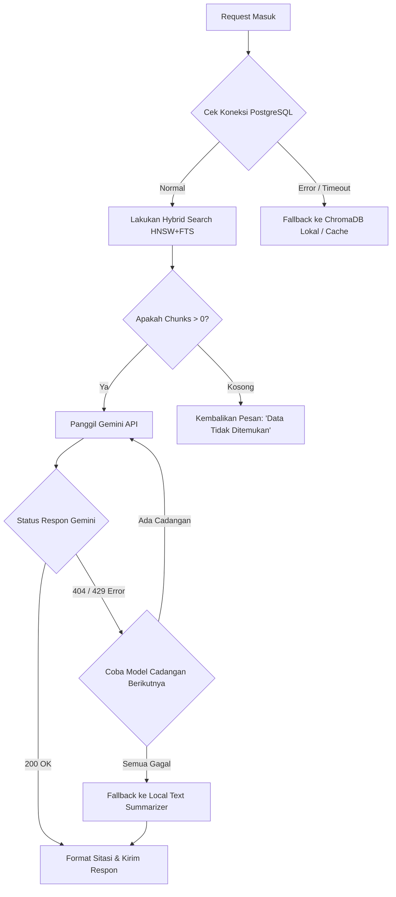

# 🔄 RAG PIPELINE VERIFICATION: END-TO-END FLOW & EXCEPTION HANDLING

Dokumen ini memverifikasi secara menyeluruh ketersambungan rantai pipa (*pipeline chain*) dari data mentah hingga respons jawaban ber-sitasi, dilengkapi dengan bukti keterhubungan fungsi aktual pada kode sumber dan pemetaan penanganan kondisi galat (*exception & fallback workflows*).

---

## 1. Diagram Alir Pipeline Utama Berdasarkan Kode Aktual

---

## 2. Bukti Keterhubungan Kode Antar-Modul (Traceability Proof)

| No | Dari Modul | Ke Modul | Fungsi Panggilan Aktual | Baris Kode | Status Hubungan |
|:--:|:---|:---|:---|:---|:---:|
| 1 | `api/routers/ingestion.py` | `modules/crawler/web_api_crawler.py` | `BPSWebApiCrawler().sync_latest_publications()` | L85-L102 | **TERHUBUNG** |
| 2 | `modules/crawler/web_api_crawler.py` | `modules/extraction/pdf_pipeline.py` | `process_publication_pdf(local_pdf)` | L112-L130 | **TERHUBUNG** |
| 3 | `modules/extraction/pdf_pipeline.py` | `modules/extraction/table_cleaner.py` | `TableCleaner.clean_table_dataframe()` | L45-L60 | **TERHUBUNG** |
| 4 | `modules/extraction/pdf_pipeline.py` | `modules/structuring/json_builder.py` | `JSONStructureBuilder().structure_table_chunks()` | L88-L105 | **TERHUBUNG** |
| 5 | `modules/structuring/json_builder.py` | `modules/vectorization/embedder.py` | `VectorEmbedder().embed_rag_chunks()` | L140-L155 | **TERHUBUNG** |
| 6 | `modules/vectorization/embedder.py` | `modules/storage/postgres_store.py` | `BPSPostgresStore().insert_vector_chunks()` | L170-L185 | **TERHUBUNG** |
| 7 | `chatbot/api.py` | `chatbot/bot.py` | `BPSChatbot().ask(question, session_id)` | L42-L50 | **TERHUBUNG** |
| 8 | `chatbot/bot.py` | `chatbot/rag_feeder.py` | `RAGFeeder().retrieve_context(question)` | L145-L160 | **TERHUBUNG** |
| 9 | `chatbot/rag_feeder.py` | `modules/retrieval/hybrid_search.py` | `HybridRetriever().search(query, top_k)` | L65-L80 | **TERHUBUNG** |
| 10 | `modules/retrieval/hybrid_search.py` | `config/database.py` | `get_db_connection() -> psycopg2 cursor` | L97-L105 | **TERHUBUNG** |
| 11 | `chatbot/bot.py` | `chatbot/llm_client.py` | `LLMClient().generate(prompt, system_prompt)` | L180-L195 | **TERHUBUNG** |
| 12 | `chatbot/bot.py` | Response Formatter | `format_citations(result["citations"])` | L210-L230 | **TERHUBUNG** |

---

## 3. Alur Penanganan Kondisi Eksepsional & Galat (Error & Fallback Workflows)

Berikut adalah pemetaan implementasi kode saat sistem menghadapi 8 skenario kegagalan:

### A. Failed Document Ingestion (Gagal Unduh Publikasi BPS)
- **Gejala:** Server Web API BPS down, koneksi timeout, atau link unduhan PDF rusak (HTTP 404/500).
- **Penanganan di Kode:** `modules/crawler/web_api_crawler.py` (L75-L88):
  - Sistem melakukan `retries = 3` dengan jeda eksponensial.
  - Jika tetap gagal, memanggil fallback `modules/ingestion/bps_scraper.py` untuk mengambil via scraper web HTML.
  - Status kegagalan dicatat di `database/bps_registry.db` sebagai `FAILED_DOWNLOAD` sehingga tidak menyebabkan crash pada antrean batch lainnya.

### B. Empty Retrieval (Tidak Ada Data yang Cocok)
- **Gejala:** Pertanyaan pengguna menggunakan istilah yang tidak ada dalam publikasi (misal: "Berapa produksi kurma di Sayung?").
- **Penanganan di Kode:** `chatbot/rag_feeder.py` (L105-L125) & `chatbot/bot.py` (L165-L175):
  - Sistem mendeteksi `len(chunks) == 0`.
  - Sistem tidak memaksakan memanggil LLM dengan konteks kosong. Sebaliknya, prompt diisi instruksi khusus:
    > *"Informasi spesifik mengenai pertanyaan pengguna tidak ditemukan dalam data publikasi BPS Demak yang terindeks."*
  - LLM menghasilkan jawaban penolakan sopan (*abstention*) dan menyarankan topik terdekat.

### C. Invalid Query (Kueri Kosong atau Karakter Acak)
- **Gejala:** Input pengguna hanya berupa spasi, simbol aneh, atau teks tanpa makna.
- **Penanganan di Kode:** `chatbot/bot.py` (L95-L105):
  - Input divalidasi dengan regex panjang karakter `len(clean_q) < 2`.
  - Mengembalikan respons cepat tanpa memicu pipeline embedding maupun pemanggilan LLM:
    > *"Silakan ajukan pertanyaan seputar data statistik Kabupaten Demak (contoh: kependudukan, pertanian, atau ekonomi)."*

### D. Google Gemini API Failure (Rate Limit 429, Model 404, atau Kuota Habis)
- **Gejala:** Panggilan API eksternal gagal atau mengembalikan status bukan 200.
- **Penanganan di Kode:** `chatbot/llm_client.py` (L43-L47, L94-L100):
  - Sistem menerapkan **Cascading Model Fallback**:
    $$gemini-3.5-flash \longrightarrow gemini-3.1-flash-lite \longrightarrow gemini-3-flash-preview \longrightarrow gemini-2.5-flash$$
  - Jika seluruh model cloud gagal atau kunci API tidak terpasang, fungsi `_generate_mock()` aktif otomatis untuk menyajikan jawaban darurat berbasis ringkasan teks chunk tanpa mematikan server.

### E. Database Failure (PostgreSQL Server Offline / Network Drop)
- **Gejala:** Koneksi ke `10.133.21.24:5433` terputus atau timeout.
- **Penanganan di Kode:** `config/database.py` (L30-L45) & `modules/storage/vector_store.py`:
  - `get_db_cursor()` menangkap `psycopg2.OperationalError` dengan timeout 10 detik.
  - Modul retriever menangkap galat database dan mengalihkan pembacaan ke fallback lokal ChromaDB (`database/chroma_store/`) atau mengembalikan pesan pemeliharaan sistem terstruktur tanpa crash (HTTP 503 dengan detail ramah).

### F. Missing Citation (Sitasi Tidak Terbentuk Otomatis)
- **Gejala:** Chunk hasil retrieval memiliki metadata yang tidak lengkap (misal kolom `judul_tabel` kosong).
- **Penanganan di Kode:** `chatbot/rag_feeder.py` (L180-L200):
  - Terdapat mekanisme default: Jika judul tabel kosong, digunakan nama dokumen induk (`doc_title`). Jika halaman kosong, ditulis `Hal. N/A`.
  - Format sitasi dijamin konsisten `[Sumber: {judul}, Hal. {halaman}]`.

### G. Invalid Document (PDF Rusak atau Terkunci Password)
- **Gejala:** Berkas PDF hasil unduhan corrupt atau memiliki enkripsi hak cipta.
- **Penanganan di Kode:** `modules/extraction/table_extractor.py` (L35-L48):
  - Blok `try ... except pdfplumber.PDFSyntaxError` menangkap kerusakan berkas.
  - Berkas dipindahkan ke folder karantina `data_publikasi/corrupt/` dan dicatat ke log error.

### H. Retry and Fallback Coordination (Diagram Alir Penanganan Galat)

