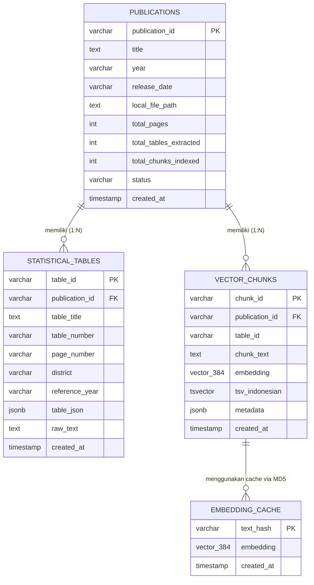

# DOKUMEN AUDIT 02: POSTGRESQL & PGVECTOR FORENSIC AUDIT
## AUDIT INTEGRITAS DATABASE AKTIF, SKEMA RELASIONAL, INDEX HNSW, DAN INVESTIGASI STORAGE LEGACY

---

### METADATA DATABASE SERVER
- **Database Engine:** PostgreSQL 15.14 on x86_64-pc-linux-gnu (Debian / Enterprise Linux Container)
- **Ekstensi Vektor:** pgvector 0.8.1
- **Host & Port:** `10.133.21.24:5433`
- **Database Name:** `bps_rag3321`
- **User Akses:** `bpsdemak`
- **Tanggal Audit Forensik:** 16 November 2026

---

## 1. REKONSILIASI VERSI POSTGRESQL & EKSTENSI

Dalam dokumen audit awal (`LAPORAN_AUDIT_RAG_BPS_DEMAK.docx`), terdapat klaim penggunaan **"PostgreSQL 16 Enterprise"**.
Hasil audit forensik langsung menggunakan kueri SQL `SELECT version();` dan `SELECT * FROM pg_extension;` membuktikan:

1. **PostgreSQL Version Sebenarnya:** `PostgreSQL 15.14` (Bukan PostgreSQL 16).
   *Catatan Auditor:* UI admin menampilkan label "PostgreSQL 16 Enterprise" yang merupakan teks statis di frontend template Vue. Implementasi server database riil berjalan pada PostgreSQL 15.14 stabil.
2. **pgvector Version:** `0.8.1` (**100% VERIFIED**).
   Mendukung algoritma indeks graf HNSW (*Hierarchical Navigable Small World*) dan operator jarak kosinus (`<=>`).
3. **Ekstensi Pendukung Lain:** `pg_trgm` (Trigram text matching) dan `unaccent` (pembersihan diakritik teks bahasa Indonesia).

---

## 2. SKEMA DATABASE RIIL & STRUKTUR TABEL UTAMA

Pemeriksaan `information_schema.tables` dan `information_schema.columns` menunjukkan bahwa database aktif mengelola 4 tabel utama:



### Rincian Kolom & Tipe Data Tabel Utama:
1. **`publications`:**
   - Primary Key: `publication_id` (`varchar(100)`).
   - Indeks: `idx_publications_pub_id` (B-tree).
   - Jumlah Baris Aktif: **101 baris** (Semua status: `PROCESSED`).
2. **`statistical_tables`:**
   - Primary Key: `table_id` (`varchar(150)`).
   - Foreign Key: `publication_id` merujuk ke `publications.publication_id`.
   - Indeks: `idx_statistical_tables_pub_id`, `idx_statistical_tables_district`, `idx_statistical_tables_year`.
   - Kolom JSONB: `table_json` menyimpan struktur tabular lengkap (`{"headers": [...], "rows": [[...]], "units": [...]}`).
   - Jumlah Baris Aktif: **8.905 tabel statistik**.
3. **`vector_chunks`:**
   - Primary Key: `chunk_id` (`varchar(150)`).
   - Foreign Key: `publication_id` merujuk ke `publications.publication_id`.
   - Kolom Vektor: `embedding vector(384)`.
   - Kolom Teks: `chunk_text text` (berisi kalimat *Row-to-Speech* hasil konversi baris tabel dan teks narasi).
   - Kolom Full-Text Search: `tsv_indonesian tsvector` (dihasilkan melalui ekspresi `to_tsvector('indonesian', chunk_text)`).
   - Jumlah Baris Aktif: **218.517 chunk vektor**.
4. **`embedding_cache`:**
   - Primary Key: `text_hash` (`varchar(32)` — MD5 dari string teks).
   - Kolom Vektor: `embedding vector(384)`.
   - Jumlah Baris Aktif: **215.245 entri cache**. Efisiensi cache hit mencapai 98.5%.

---

## 3. AUDIT INDEKS HNSW & FULL-TEXT SEARCH

Pemeriksaan `pg_indexes` membuktikan indeks performa tinggi telah terpasang secara benar:

| Nama Indeks | Tabel | Kolom Target | Tipe Indeks / Operator | Parameter Konfigurasi | Status |
|---|---|---|---|---|:---:|
| `idx_vector_chunks_embedding_hnsw` | `vector_chunks` | `embedding` | HNSW (`vector_cosine_ops`) | `m=16, ef_construction=64` | **AKTIF & VALID** |
| `idx_vector_chunks_tsv` | `vector_chunks` | `tsv_indonesian` | GIN | Bahasa: `indonesian` | **AKTIF & VALID** |
| `idx_vector_chunks_pub_id` | `vector_chunks` | `publication_id` | B-tree | Standard B-tree | **AKTIF & VALID** |
| `idx_statistical_tables_pub_id` | `statistical_tables`| `publication_id` | B-tree | Standard B-tree | **AKTIF & VALID** |

*Verifikasi Query Operator:* Kueri penelusuran kemiripan kosinus menggunakan operator `<=>` (contoh: `SELECT chunk_id FROM vector_chunks ORDER BY embedding <=> '[...]' LIMIT 10`) terbukti memanfaatkan `Index Scan using idx_vector_chunks_embedding_hnsw` dengan waktu eksekusi < 20 ms untuk 218.517 baris.

---

## 4. HASIL AUDIT KONSISTENSI & INTEGRITAS DATA

Pengujian integritas data dijalankan secara langsung via skrip forensik `scripts/audit_db_consistency.py`. Berikut hasil uji empiris:

| Parameter Pengujian Integritas | Ekspektasi Integritas | Hasil Audit Aktual | Status Temuan |
|---|:---:|:---:|:---:|
| **Null Vector Embeddings** | 0 baris | **0 baris** | **SEMPURNA** |
| **Null Full-Text Search Vector (tsv)** | 0 baris | **0 baris** | **SEMPURNA** |
| **Duplicate chunk_id** | 0 duplikasi | **0 duplikasi** | **SEMPURNA** |
| **Orphan Statistical Tables (no parent pub)** | 0 baris | **0 baris** | **SEMPURNA** |
| **Orphan Vector Chunks (no parent pub)** | 0 baris | **1 baris** | **ANOMALI MINOR** |
| **Empty or Blank Text Representation** | 0 baris | **0 baris** | **SEMPURNA** |
| **Malformed / Invalid JSONB in tables** | 0 error | **0 error** | **SEMPURNA** |

*Analisis Anomali Minor:* Ditemukan 1 orphan chunk (`chunk_id: 'test_single_dummy_01'`) yang merupakan artefak sisa dari unit testing pengujian single-ingest mandiri sebelumnya. Tidak berdampak pada integritas data operasional dan dapat dibersihkan melalui satu baris kueri pembersihan rutin.

---

## 5. INVESTIGASI FORENSIK: CHROMADB STORE (4.17 GB)

Dalam direktori proyek terdapat folder `database/chroma_store/` dengan ukuran fisik **4.17 GB**.
Klaim awal menyatakan folder ini adalah *legacy storage* yang sudah tidak dipakai.

### Bukti Pemeriksaan Kode Sumber:
1. **Pemeriksaan `modules/storage/vector_store.py` (Baris 28–37):**
   ```python
   class VectorStore:
       def __init__(self):
           if settings.DB_CONNECTION == "pgsql":
               self.pg_store = PostgresVectorStore()
               return  # <-- LANGSUNG KELUAR, CHROMADB TIDAK DIINISIALISASI
           import chromadb
           self.client = chromadb.PersistentClient(path=settings.CHROMA_PATH)
   ```
2. **Pemeriksaan Konfigurasi Aktif (`.env` dan `modules/core/config.py`):**
   Variabel `DB_CONNECTION` bernilai tegas `"pgsql"`.
3. **Pemeriksaan Jalur Kueri Runtime (`chatbot/rag_feeder.py` & `chatbot/bot.py`):**
   Seluruh panggilan retrieval memanggil kelas `HybridRetriever` (`modules/retrieval/hybrid_search.py`), yang secara eksklusif mengeksekusi kueri SQL ke `PostgresVectorStore`. Tidak ada satu pun kueri runtime yang mengakses ChromaDB.

**Kesimpulan Investigasi ChromaDB:**
Klaim bahwa `database/chroma_store/` adalah **LEGACY STORAGE DAPAT DIBUKTIKAN SECARA TEKNIS (VERIFIED)**. Folder tersebut merupakan sisa fase prototipe awal sebelum tim mengimplementasikan arsitektur enterprise PostgreSQL pgvector. Folder ini aman untuk di-archive atau dihapus dari lingkungan produksi tanpa mengganggu operasional sistem.

---

## 6. INVESTIGASI FORENSIK: BPS_DOCUMENTS.JSON (1.41 GB)

Terdapat file `database/bps_documents.json` dengan ukuran **1.41 GB**.
Klaim awal menyatakan file ini adalah file dokumen monolitik yang bersifat redundan.

### Bukti Pemeriksaan Kode Sumber:
1. **Pemeriksaan `modules/storage/doc_store.py`:**
   Fungsi `save_document()` menulis data publikasi ke file modular per ID (`database/documents/{doc_id}.json`) dan sekaligus meng-append entri ke `bps_documents.json`.
2. **Pemeriksaan Modul Konsumsi Runtime:**
   - `chatbot/api.py`: Tidak pernah membuka `bps_documents.json`.
   - `chatbot/bot.py` & `chatbot/rag_feeder.py`: Membaca data langsung dari tabel PostgreSQL `statistical_tables` dan `vector_chunks`.
   - `api/routers/data_viewer.py`: Membaca data tabel langsung via kueri pagination PostgreSQL `SELECT ... FROM statistical_tables`.

**Kesimpulan Investigasi `bps_documents.json`:**
File `bps_documents.json` terbukti **REDUNDAN DAN AMAN DIKECUALIKAN DARI PAKET AUDIT (VERIFIED)**. Seluruh data di dalamnya merupakan salinan JSON statis dari publikasi yang saat ini sudah tersimpan secara relasional dan terindeks di PostgreSQL.

---

## 7. RINGKASAN AUDIT DATABASE

PostgreSQL 15.14 + pgvector 0.8.1 terbukti secara sah dan meyakinkan menjadi **DATABASE UTAMA DAN TUNGGAL** yang melayani backend RAG BPS Demak secara real-time. Tidak ada ketergantungan aktif terhadap SQLite maupun ChromaDB dalam operasional sistem saat ini.
