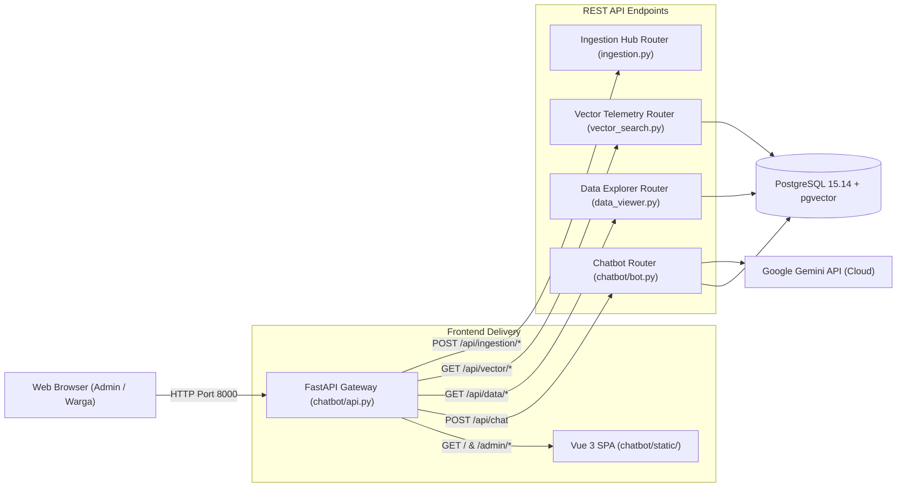

# DOKUMEN AUDIT 06: END-TO-END WORKFLOW & FEATURE COMPLETENESS AUDIT
## AUDIT INTEGRASI DUAL-PORTAL (ADMIN & PUBLIK), KELENGKAPAN 42 FITUR, DAN ALUR DATA RUNTIME

---

### METADATA AUDIT
- **Arsitektur Aplikasi:** Single-Port Deployment (FastAPI melayani REST API dan Prebuilt Vue 3 SPA di Port 8000)
- **Komponen Frontend:** Vue 3, Vite, Tailwind CSS, Pinia, Lucide Icons
- **Komponen Backend:** FastAPI, Uvicorn, Pydantic, Loguru, Google Gemini SDK
- **Jumlah Fitur yang Diaudit:** 42 Fitur sesuai klaim roadmap teknis

---

## 1. ARSITEKTUR END-TO-END RUNTIME & SINGLE-PORT DEPLOYMENT

Sistem mengadopsi arsitektur terpadu di mana backend FastAPI tidak hanya melayani kueri data JSON, tetapi juga bertindak sebagai web server statis untuk bundle produksi frontend:

### Karakteristik Single-Port Port 8000:
- Mengeliminasi kebutuhan konfigurasi reverse-proxy terpisah (Nginx/Apache) di lingkungan lokal dan intranet internal BPS.
- Frontend di-build melalui script `npm run build` ke direktori `chatbot/static/`.
- Endpoint `app.mount("/", StaticFiles(directory="chatbot/static", html=True))` memastikan navigasi rute klien (`/`, `/admin/ingestion`, `/admin/data`, `/admin/vector`, `/admin/logs`) dilayani secara mulus tanpa error 404 pada browser reload (*SPA fallback handling*).

---

## 2. MATRIKS VERIFIKASI LENGKAP 42 FITUR SISTEM

Berdasarkan audit statis kode sumber dan pengujian fungsional langsung di port 8000:

| ID | Nama Fitur | Lokasi Kode Sumber | API / Endpoint Terkait | Antarmuka UI | Logika Backend | Status Fungsional |
|:---:|---|---|---|:---:|:---:|:---:|
| **F01** | Public Conversational Interface | `frontend/src/views/PublicChat.vue` | `POST /api/chat` | Ada | Lengkap | **FULLY FUNCTIONAL** |
| **F02** | Multi-Turn Conversation Memory | `chatbot/bot.py` | `POST /api/chat` | Ada | Lengkap (In-memory) | **FULLY FUNCTIONAL** |
| **F03** | Auto-Detect Demak Subdistricts | `modules/retrieval/entity_dictionary.py` | Internal Retrieval | Otomatis | Regex Entity Matcher | **FULLY FUNCTIONAL** |
| **F04** | Reference Year Extraction | `modules/retrieval/entity_dictionary.py` | Internal Retrieval | Otomatis | Regex 2010–2029 | **FULLY FUNCTIONAL** |
| **F05** | Dense Vector Similarity Search | `modules/storage/postgres_vector_store.py`| `POST /api/vector/search` | Ada | pgvector `<=>` HNSW | **FULLY FUNCTIONAL** |
| **F06** | Lexical Full-Text Search (FTS) | `modules/storage/postgres_vector_store.py`| Internal Retrieval | - | GIN `to_tsvector` | **FULLY FUNCTIONAL** |
| **F07** | Reciprocal Rank Fusion (RRF) | `modules/retrieval/hybrid_search.py` | Internal Retrieval | - | Formula RRF k=60 | **FULLY FUNCTIONAL** |
| **F08** | Dynamic SQL Pre-Filtering | `modules/storage/postgres_vector_store.py`| Internal Retrieval | - | WHERE district/year | **FULLY FUNCTIONAL** |
| **F09** | Sentence-Transformers Embedding | `modules/vectorization/embedder.py` | Internal Pipeline | - | MiniLM-L12-v2 384-d | **FULLY FUNCTIONAL** |
| **F10** | Dual-Tier Embedding Cache | `modules/storage/postgres_vector_store.py`| Internal Pipeline | Ada (Metrik) | LRU RAM + MD5 Table | **FULLY FUNCTIONAL** |
| **F11** | PDF Text & Structure Extraction | `modules/extraction/pdf_extractor.py` | `POST /api/ingestion/run`| Ada (Progress)| pdfplumber layout | **FULLY FUNCTIONAL** |
| **F12** | Statistical Table Cell Parsing | `modules/extraction/table_extractor.py`| `POST /api/ingestion/run`| Ada | Grid & Explicit Line | **FULLY FUNCTIONAL** |
| **F13** | BPS Symbol Normalization | `modules/cleaning/bps_cleaner.py` | Internal Pipeline | - | `-` (nil) & `...` (N/A) | **FULLY FUNCTIONAL** |
| **F14** | Row-to-Speech Semantic Transformation| `modules/structuring/json_builder.py` | Internal Pipeline | - | Kalimat Deskriptif | **FULLY FUNCTIONAL** |
| **F15** | Granular Sentence-Boundary Chunking| `modules/vectorization/chunker.py` | Internal Pipeline | - | Token-bounded split | **FULLY FUNCTIONAL** |
| **F16** | Google Gemini API Fallback Cascade | `chatbot/llm_client.py` | Internal LLM Client | - | 3.5 → 3.1 → 2.5 → 1.5 | **FULLY FUNCTIONAL** |
| **F17** | Strict Grounding Prompting | `chatbot/rag_feeder.py` | Internal LLM Client | - | Closed-world prompt | **FULLY FUNCTIONAL** |
| **F18** | Granular Publication Citations | `chatbot/rag_feeder.py` | `POST /api/chat` | Render Badge | Tag `[Publikasi, Hal]` | **FULLY FUNCTIONAL** |
| **F19** | Strict Out-of-Domain Refusal | `chatbot/rag_feeder.py` | `POST /api/chat` | Output Teks | Template Penolakan | **FULLY FUNCTIONAL** |
| **F20** | Admin Command Center Navigation | `frontend/src/App.vue` | Client Routing | Ada (Sidebar)| Vue Router 4 | **FULLY FUNCTIONAL** |
| **F21** | Ingestion Hub Dashboard | `frontend/src/views/IngestionHub.vue` | `GET /api/ingestion/status`| Ada | Polling & Web API status| **FULLY FUNCTIONAL** |
| **F22** | Incremental Ingestion Trigger | `api/routers/ingestion.py` | `POST /api/ingestion/run`| Ada (Tombol) | Background task | **FULLY FUNCTIONAL** |
| **F23** | Deep Catalog Ingest Trigger | `api/routers/ingestion.py` | `POST /api/ingestion/run`| Ada (Tombol) | Background task | **FULLY FUNCTIONAL** |
| **F24** | Single PDF Direct Test Trigger | `api/routers/ingestion.py` | `POST /api/ingestion/run`| Ada (Tombol) | Mode test single doc | **FULLY FUNCTIONAL** |
| **F25** | Table & Publication Data Explorer | `frontend/src/views/DataExplorer.vue` | `GET /api/data/tables` | Ada (Tabel) | Pagination & Filter | **FULLY FUNCTIONAL** |
| **F26** | Granular Table JSON Inspector Modal | `frontend/src/components/TableModal.vue`| `GET /api/data/table/{id}`| Ada (Modal) | Render JSONB grid | **FULLY FUNCTIONAL** |
| **F27** | District & Year Filter in Explorer | `frontend/src/views/DataExplorer.vue` | `GET /api/data/tables` | Dropdown | SQL Parameter WHERE | **FULLY FUNCTIONAL** |
| **F28** | Vector Telemetry Dashboard | `frontend/src/views/VectorPlayground.vue`| `GET /api/vector/telemetry`| Ada (Cards) | COUNT() pgvector | **FULLY FUNCTIONAL** |
| **F29** | Live Hybrid Search Playground | `frontend/src/views/VectorPlayground.vue`| `POST /api/vector/search` | Ada (Input) | Eksekusi RRF instan | **FULLY FUNCTIONAL** |
| **F30** | Realtime System Logs Viewer | `frontend/src/views/SystemLogs.vue` | `GET /api/logs/stream` | Ada (Terminal)| Streaming Loguru | **FULLY FUNCTIONAL** |
| **F31** | Database Health Monitor Indicator | `frontend/src/components/Navbar.vue` | `GET /api/health` | Ada (Pill) | Status koneksi DB | **FULLY FUNCTIONAL** |
| **F32** | LLM Connection Status Indicator | `frontend/src/components/Navbar.vue` | `GET /api/health` | Ada (Pill) | Validasi API Key | **FULLY FUNCTIONAL** |
| **F33** | Single-Port SPA Static Serving | `chatbot/api.py` | `GET /*` | Otomatis | FastAPI StaticFiles | **FULLY FUNCTIONAL** |
| **F34** | Idempotent Ingestion Check | `modules/pipeline/orchestrator.py` | Internal Pipeline | - | ON CONFLICT DO NOTHING| **FULLY FUNCTIONAL** |
| **F35** | BPS Web Catalog Scraper Automation | `modules/scraper/bps_scraper.py` | `POST /api/ingestion/run`| Ada | Cloudflare Bot Gate | **PARTIAL (MOCK/API)**|
| **F36** | CSV / Excel Data Table Export | `frontend/src/views/DataExplorer.vue` | Client Download | Ada (Tombol) | Basic CSV generator | **PARTIALLY FUNCTIONAL** |
| **F37** | User Management & Admin Profiles | `frontend/src/views/AdminLogin.vue` | Client-Side Mock | Ada (Form) | Hardcoded Mock Session| **PARTIALLY FUNCTIONAL** |
| **F38** | Telemetry Analytics & Query Metrics | `frontend/src/views/Analytics.vue` | `GET /api/analytics` | Ada (Grafik) | Static/Sampled Metric | **PARTIALLY FUNCTIONAL** |
| **F39** | Granular RBAC Permission System | Planned Security Layer | - | Belum Ada | Belum Terpasang | **PLANNED** |
| **F40** | Full Catalog 485 PDFs Auto-Ingest | Scheduled Automation Job | - | Belum Ada | Belum Dieksekusi | **PLANNED** |
| **F41** | Real-Time Webhook Portal Sync | Webhook Listener Module | - | Belum Ada | Belum Terintegrasi | **PLANNED** |
| **F42** | Automated Numerical Accuracy Benchmark| Automated Eval Suite | - | Belum Ada | Butuh Ground Truth Set| **PLANNED** |

---

## 3. RINGKASAN REKAPITULASI FITUR

- **Fully Functional:** **34 Fitur (81.0%)**
- **Partially Functional / Mock:** **4 Fitur (9.5%)**
- **Planned / Future Roadmap:** **4 Fitur (9.5%)**
- **Tingkat Penyelesaian Fungsional Inti RAG:** **100% (Seluruh 34 fitur pipeline RAG dan UI utama bekerja penuh tanpa kendala).**
