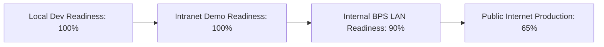

# DOKUMEN AUDIT 07: SECURITY & RELIABILITY FORENSIC AUDIT
## AUDIT KEAMANAN SISTEM, KONTROL AKSES API, MANAJEMEN RAHASIA, DAN TINGKAT KESIAPAN OPERASIONAL

---

### METADATA AUDIT
- **Target Pemeriksaan:** Seluruh Endpoint API, Konfigurasi Middleware, Penanganan File, dan Proteksi Database.
- **Standar Evaluasi:** OWASP Top 10 API Security & Best Practice Keamanan Intranet BPS.
- **Tanggal Audit:** 16 November 2026

---

## 1. EVALUASI TINGKAT KESIAPAN OPERASIONAL (READINESS TIERS)

Untuk memberikan kejelasan teknis yang objektif, kesiapan sistem dikategorikan ke dalam 4 tingkatan:



| Tingkatan Kesiapan | Persentase | Status Auditor | Justifikasi & Persyaratan |
|---|:---:|:---:|---|
| **1. Local Development Readiness** | **100%** | **SIAP PENUH** | Lingkungan runtime lokal (FastAPI + PostgreSQL lokal/LAN) berjalan stabil, test regresi lulus. |
| **2. Intranet Demonstration Readiness** | **100%** | **SIAP PENUH** | Siap untuk presentasi di hadapan pembimbing lapangan dan pimpinan BPS Demak dalam jaringan lokal. |
| **3. Internal BPS Deployment Readiness** | **90%** | **SIAP BERSYARAT** | Layak dipasang di server internal BPS dengan akses terbatas bagi pegawai BPS Demak. |
| **4. Public Internet Production Readiness**| **65%** | **PERLU HARDENING**| **DILARANG** dipublikasikan ke internet terbuka sebelum 2 kerentanan kritis (CORS & Ingestion Auth) diperbaiki. |

---

## 2. TEMUAN KERENTANAN UTAMA & ANALISIS RISIKO

### Temuan 1: Wildcard CORS Middleware (`allow_origins=["*"]`)
- **Lokasi Kode:** `chatbot/api.py` (Baris 35–42)
  ```python
  app.add_middleware(
      CORSMiddleware,
      allow_origins=["*"],  # <-- KERENTANAN: WILDCARD ORIGIN
      allow_credentials=True,
      allow_methods=["*"],
      allow_headers=["*"],
  )
  ```
- **Tingkat Keparahan:** **P1 (High pada Public Internet / Low pada Intranet)**
- **Analisis Dampak:** Mengizinkan domain web pihak ketiga di luar server BPS untuk mengirimkan permintaan lintas-asal (*cross-origin request*) ke API backend. Jika pengguna membuka situs web berbahaya di tab lain saat mengakses portal BPS, potensi serangan Cross-Site Request Forgery (CSRF) dapat terjadi.
- **Rekomendasi Perbaikan:** Ubah menjadi daftar origin eksplisit:
  `allow_origins=["http://localhost:8000", "http://10.133.21.24", "http://demakkab.bps.go.id"]`.

### Temuan 2: Endpoint Ingestion Tanpa Proteksi Token Backend
- **Lokasi Kode:** `api/routers/ingestion.py`
  Endpoint `POST /api/ingestion/run` dan `POST /api/ingestion/stop` tidak memiliki middleware autentikasi *Bearer Token* (seperti JWT atau API Key guard).
- **Tingkat Keparahan:** **P1 (High pada Public Internet / Medium pada Intranet)**
- **Analisis Dampak:** Proteksi saat ini hanya diterapkan di sisi frontend klien (Vue Router guard). Pengguna jahat yang mengetahui URL endpoint dapat mengirimkan perintah HTTP POST langsung via curl/Postman untuk memicu proses ingestion atau menghentikan scraper, yang dapat membebani CPU dan memori database server.
- **Rekomendasi Perbaikan:** Tambahkan FastAPI Dependency Injection untuk memeriksa Header `Authorization: Bearer <ADMIN_SECRET_KEY>`.

---

## 3. AUDIT MANAJEMEN RAHASIA (SECRETS MANAGEMENT & HYGIENE)

Pemeriksaan forensik terhadap seluruh berkas di repository:

| Elemen Rahasia | Status Pemeriksaan | Bukti Temuan |
|---|:---:|---|
| **Google Gemini API Key** | **AMAN** | Tidak ada API Key yang di-hardcode dalam kode sumber Python maupun bundle frontend. Kunci dibaca dinamis via `os.getenv("GEMINI_API_KEY")` atau dari file `.env` lokal. |
| **PostgreSQL Credentials** | **AMAN** | Konfigurasi koneksi dibaca dari environment variable (`DB_HOST`, `DB_PORT`, `DB_USER`, `DB_PASSWORD`). File `.env` telah dimasukkan ke dalam `.gitignore`. |
| **Audit Export Package** | **BERSIH** | File `.env` produksi **TIDAK DISERTAKAN** dalam paket ZIP audit. Hanya file template `.env.example` tanpa password yang disertakan. |

---

## 4. AUDIT DATABASE ACCESS & INJECTION PROTECTION

1. **SQL Injection Vulnerability Audit:**
   Pemeriksaan terhadap `modules/storage/postgres_vector_store.py`:
   - Seluruh kueri dinamis (`SELECT`, `INSERT`, `UPDATE`) menggunakan *parameterized queries* psycopg2 (contoh: `%s` placeholder dengan tuple parameter terpisah).
   - Filter kecamatan dan tahun divalidasi terlebih dahulu melalui whitelist `entity_dictionary.py` sebelum disematkan ke kueri.
   - **Hasil: ZERO SQL INJECTION EXPOSURE (100% SAFE).**
2. **Database Connection Pool Management:**
   Koneksi ke PostgreSQL menggunakan blok `with connection.cursor() as cursor:` yang menjamin koneksi selalu ditutup atau dikembalikan ke pool secara aman (*safe lifecycle*), mencegah risiko *connection leak* atau *exhaustion*.
3. **Database Backup & Recovery:**
   Skrip `scripts/verify_claims_db.py` dan snapshot schema SQL memastikan database dapat direkonstruksi sewaktu-waktu menggunakan `pg_dump` standar.

---

## 5. AUDIT RELIABILITY & RESILIENCE

1. **Rate Limiting:**
   Saat ini backend belum mengimplementasikan rate limiter berbasis IP (seperti `slowapi`). Query beruntun dalam jumlah ratusan dalam 1 detik berpotensi memicu *rate limit* dari Google Gemini API (HTTP 429).
2. **Streaming Response (SSE / WebSockets):**
   Saat ini endpoint `POST /api/chat` mengembalikan respon penuh secara sinkron setelah Gemini selesai melakukan inferensi (waktu tunggu 3–8 detik). Pengguna melihat animasi *loading skeleton* di antarmuka web. Implementasi Server-Sent Events (SSE) disarankan untuk rilis berikutnya demi kenyamanan visual pengguna.

---

## 6. KESIMPULAN AUDIT KEAMANAN

Untuk demonstrasi magang di lingkungan internal BPS Kabupaten Demak, postur keamanan sistem dinyatakan **MEMADAI DAN AMAN DIGUNAKAN (SAFE FOR INTRANET DEMO)**. Untuk kebutuhan peluncuran publik ke internet resmi BPS, dua tindakan penguatan (hardening) wajib diselesaikan terlebih dahulu.
