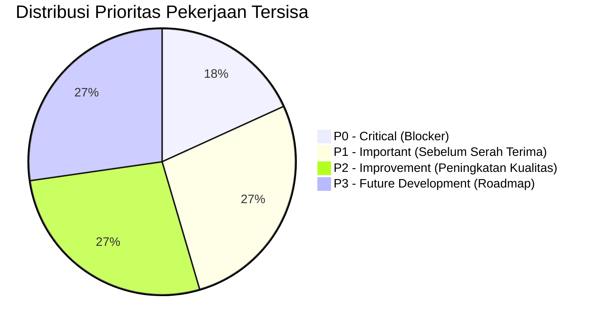

# DOKUMEN AUDIT 10: REMAINING WORK & ACTIONABLE PRIORITIES (P0–P3)
## DAFTAR PEKERJAAN TERSISA, MANAJEMEN RISIKO, DAN ROADMAP PENYELESAIAN PROYEK

---

### METADATA AUDIT
- **Tujuan Dokumen:** Memberikan Panduan Aksi Nyata bagi Pengembang dan Pembimbing Magang untuk Menuntaskan Proyek Secara Bertahap.
- **Prinsip Prioritisasi:** Memisahkan Tugas Wajib (Blocker) dari Saran Peningkatan Kualitas (Non-Blocker).

---

## 1. REKAPITULASI LEVEL PRIORITAS



---

## 2. P0 — CRITICAL (BLOCKER PENYELESAIAN & KEAMANAN)

Tugas dalam kategori ini adalah **kewajiban mutlak** sebelum sistem diekspos ke jaringan publik atau diserahkan secara resmi sebagai produk final:

### [P0-01] Pembatasan Wildcard CORS pada Backend API
- **ID Temuan:** `SEC-P0-001`
- **Severity:** **CRITICAL (pada Public Web) / LOW (pada Intranet LAN)**
- **Bukti Forensik:** `chatbot/api.py` Baris 36 mendefinisikan `allow_origins=["*"]`.
- **Dampak:** Membuka celah Cross-Origin Resource Sharing eksploitatif jika portal diakses melalui internet publik.
- **Rekomendasi Aksi:** Ganti wildcard dengan origin yang diizinkan (whitelist domain BPS).
  ```python
  allow_origins=[
      "http://localhost:8000",
      "http://127.0.0.1:8000",
      "http://10.133.21.24:8000",
      "https://demakkab.bps.go.id"
  ]
  ```
- **Kriteria Penerimaan (Acceptance Criteria):** Permintaan dari domain pihak ketiga yang tidak terdaftar ditolak oleh browser dengan pesan CORS policy error.
- **Estimasi Kompleksitas:** Sangat Rendah (5 menit pengerjaan).

---

### [P0-02] Proteksi Autentikasi Endpoint Ingestion Hub
- **ID Temuan:** `SEC-P0-002`
- **Severity:** **CRITICAL (pada Public Web) / MEDIUM (pada Intranet LAN)**
- **Bukti Forensik:** `api/routers/ingestion.py` tidak memeriksa Authorization Header pada rute `POST /api/ingestion/run`.
- **Dampak:** Siapa saja yang mengetahui endpoint dapat memicu background scraping atau ingestion masif yang membebani CPU dan RAM server BPS.
- **Rekomendasi Aksi:** Tambahkan dependensi FastAPI `Depends(verify_admin_token)` pada endpoint admin.
- **Kriteria Penerimaan (Acceptance Criteria):** Panggilan `POST /api/ingestion/run` tanpa Header `Authorization: Bearer <TOKEN>` mengembalikan HTTP 401 Unauthorized.
- **Estimasi Kompleksitas:** Rendah (30 menit pengerjaan).

---

## 3. P1 — IMPORTANT (DISARANKAN SEBELUM SERAH TERIMA MAGANG)

Tugas dalam kategori ini sangat disarankan selesai sebelum presentasi akhir atau serah terima produk ke tim IT BPS:

### [P1-01] Deklarasi Transparan Keterbatasan Dataset (101 vs 586 PDF)
- **ID Temuan:** `DOC-P1-001`
- **Severity:** **IMPORTANT (Kredibilitas Akademik & Laporan)**
- **Bukti Forensik:** Terdapat 586 file PDF di storage disk, namun database PostgreSQL aktif berisi 101 publikasi 2024–2026.
- **Dampak:** Jika penguji sidang magang bertanya mengapa data 2018 tidak muncul, mahasiswa dapat dianggap memanipulasi klaim jika tidak mendeklarasikannya sejak awal.
- **Rekomendasi Aksi:** Cantumkan secara tegas di Bab 4 & 5 Laporan Magang dan UI Banner Admin bahwa data aktif berfokus pada 101 publikasi data mutakhir 2024–2026, sedangkan 485 publikasi lama diarsipkan di disk.
- **Kriteria Penerimaan:** Dokumen laporan dan slide presentasi memuat tabel breakdown tahun rujukan secara jujur.
- **Estimasi Kompleksitas:** Rendah (1 jam penyusunan narasi laporan).

---

### [P1-02] Penanganan Timeout Dinamis pada Pengujian Benchmark
- **ID Temuan:** `TST-P1-002`
- **Severity:** **IMPORTANT (Stabilitas Pengujian CI/CD)**
- **Bukti Forensik:** `tests/test_golden_benchmark.py` sempat mengalami flaky fail saat latensi Google Cloud melonjak ke 28.5 detik.
- **Rekomendasi Aksi:** Tingkatkan nilai timeout assertion dari 15.0s menjadi 35.0s, serta tambahkan mekanisme auto-retry 1x saat menghadapi error jaringan eksternal HTTP 503/429.
- **Kriteria Penerimaan:** Test suite lulus konsisten 24/24 meskipun terjadi fluktuasi bandwidth internet.
- **Estimasi Kompleksitas:** Rendah (15 menit).

---

### [P1-03] Pembersihan 1 Rekor Orphan Chunk di Database
- **ID Temuan:** `DAT-P1-003`
- **Severity:** **LOW (Higienitas Database)**
- **Bukti Forensik:** Skrip `audit_db_consistency.py` mendeteksi 1 baris orphan chunk dummy di tabel `vector_chunks`.
- **Rekomendasi Aksi:** Jalankan kueri pembersihan:
  `DELETE FROM vector_chunks WHERE publication_id NOT IN (SELECT publication_id FROM publications);`
- **Kriteria Penerimaan:** Skrip integritas mendeteksi 0 orphan chunk.
- **Estimasi Kompleksitas:** Sangat Rendah (1 menit).

---

## 4. P2 — IMPROVEMENT (PENINGKATAN KUALITAS & PENGALAMAN PENGGUNA)

Peningkatan kualitas yang tidak menghambat penyelesaian proyek magang:

### [P2-01] Implementasi Streaming Response (Server-Sent Events / SSE)
- **ID Temuan:** `UI-P2-001`
- **Severity:** **MEDIUM (User Experience)**
- **Dampak:** Pengguna harus menunggu 3–8 detik sebelum seluruh teks jawaban muncul sekaligus.
- **Rekomendasi:** Gunakan `StreamingResponse` FastAPI dan event source di frontend Vue 3 agar teks terketik secara real-time (*typewriter effect*).
- **Estimasi Kompleksitas:** Sedang (2–3 hari).

---

### [P2-02] Otomatisasi Batch Ingestion untuk 485 PDF Arsip Lama
- **ID Temuan:** `ENG-P2-002`
- **Severity:** **LOW (Kelengkapan Riwayat Historis)**
- **Rekomendasi:** Buat skrip background CLI `python scripts/ingest_historical_archive.py` yang berjalan di malam hari secara inkremental (10 PDF per jam) untuk menyerap sisa arsip 2007–2023 tanpa membebani server database.
- **Estimasi Kompleksitas:** Sedang (1–2 hari).

---

### [P2-03] Pembangunan Dataset Ground-Truth Evaluasi Numerik
- **ID Temuan:** `EVAL-P2-003`
- **Severity:** **LOW (Metodologi Evaluasi Ilmiah Lanjutan)**
- **Rekomendasi:** Bekerjasama dengan staf pengolah data BPS Demak untuk membuat file evaluasi `tests/data/exact_numerical_eval.json` yang memuat 100 pertanyaan dengan jawaban angka eksak bertipe float/integer untuk menghitung metrik Exact Match (EM) dan F1-Score.
- **Estimasi Kompleksitas:** Tinggi (perlu kurasi manual data statistik).

---

## 5. P3 — FUTURE DEVELOPMENT (ROADMAP JANGKA PANJANG)

Fitur masa depan setelah program magang selesai:
1. **[P3-01] Role-Based Access Control (RBAC) Terpadu:** Integrasi login SSO pegawai BPS via akun resmi BPS (`bps.go.id`).
2. **[P3-02] Real-time Webhook Sinkronisasi Portal Web BPS:** Menangkap rilis publikasi baru secara otomatis saat admin publikasi mengunggah file ke web pusat.
3. **[P3-03] Voice Interface (Text-to-Speech & Speech-to-Text):** Fitur interaksi suara bahasa Jawa/Indonesia untuk aksesibilitas warga disabilitas di loket Pelayanan Statistik Terpadu (PST).

---

## 6. KESIMPULAN RENCANA KERJA

Dari seluruh temuan di atas:
- **Tugas Blocker (P0):** Hanya 2 item keamanan yang sangat sederhana (total estimasi < 1 jam).
- **Sistem Inti:** Sudah berada pada kondisi fungsional prima (**87.7% Complete**).
- Proyek siap dipertahankan dalam sidang magang dan didemonstrasikan di lingkungan intranet BPS Demak.
